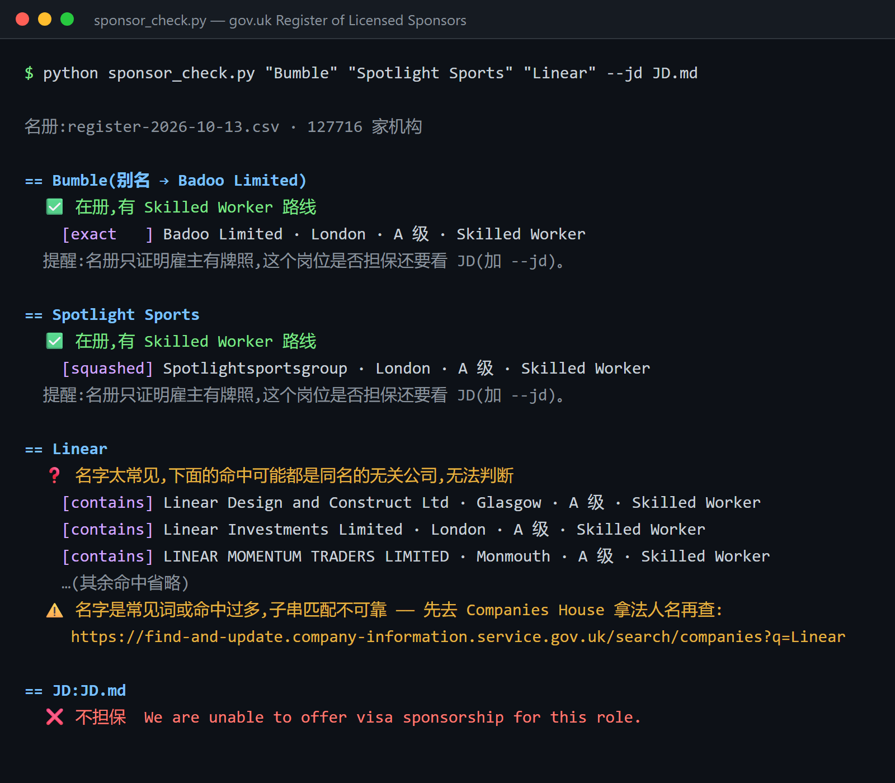

# Evidence-First Job Search · 证据优先的 AI 求职工作流

[](https://github.com/suzyeth/evidence-first-job-search/actions/workflows/ci.yml)

[English](README.md)

核心原则：**每一句都要有证据**。简历上每条经历都能在你自己的事实库里找到出处，每个岗位都要在雇主自己的招聘页上确认还在招。**专门针对英国市场**：从发现岗位、判断岗位死活、查签证担保，到 JD 定制简历、投前评审、跟进、谈薪，整条链路都有。

不绑定某一个 AI：Claude Code、Codex、Cursor、Gemini CLI 都能直接读；只用 ChatGPT / DeepSeek 之类的聊天 AI 也可以，把对应的文件贴进去就行。

## 只想查签证担保？3 步上手



不用会 git，不用 AI 工具，也不用装任何依赖。只需要装好 [Python 3.10 以上版本](https://www.python.org/downloads/)（Windows 安装时记得勾选 "Add python.exe to PATH"）。

1. 在本页点绿色的 **Code** 按钮 → **Download ZIP**，下载后解压。
2. 进入解压出来的文件夹里的 `scripts` 目录，在这里打开命令行（Windows：打开这个文件夹，在地址栏输入 `cmd` 回车）。
3. 输入要查的公司名，运行：

   ```bash
   python sponsor_check.py "Bumble" "Monzo" "Wise"
   ```

   Windows 上提示找不到 `python` 的话，把 `python` 换成 `py`；Mac 上用 `python3`。第一次运行会自动下载当天的名册（约 10 MB，十秒左右），之后一天内直接用缓存。把 JD 存成文本文件，加上 `--jd JD.txt`，还能顺便扫描 JD 里写的是愿意担保还是不担保。

查不到某家公司？它可能是用另一个法人名登记的。结果里会给出 Companies House 的链接，方便你反查法人名；也欢迎[在这里提交](https://github.com/suzyeth/evidence-first-job-search/issues/new?template=sponsor-alias.yml)，我核实后加进对照表。

## 为什么做这个

市面上的 AI 求职工具大多默认美国市场，英国求职特有的坑基本没人管：

- **签证担保怎么查？** 光看 JD 不够，雇主得在 gov.uk 持牌担保名册里。名册要按**法人名**查，商号查不到不代表没有牌照。`scripts/sponsor_check.py` 一条命令搞定：自动下载当天名册，处理连写、t/a 商号、带逗号的长名、常见词公司名这几种坑，内置「商号 → 法人名」对照，查不到时给出 Companies House 链接，还会扫 JD 里愿不愿意担保的措辞。
- **LinkedIn 上的岗位到底还在不在？** 已经下架的岗位，LinkedIn 照样返回正常页面。这里写了可靠的判死方法，以及英国公司常用的招聘系统（Greenhouse / Ashby / Lever / Workable / Teamtailor…）的公开接口，可以直接去雇主那边核实。
- **英国的岗位有 Indeed UK 这个盲区**，LinkedIn 覆盖不到，脚本两边一起扫。
- **英国游戏 / 科技行业的薪资区间**、谈薪流程、签证担保年限这类隐性筹码。

## 包含什么

| 环节 | 内容 |
|------|------|
| 找岗位 | `scripts/sweep.py`:LinkedIn + Indeed 增量扫描（断点续跑、跨站去重、过滤 Senior 岗和中介）；`scripts/boardsweep.py`:直接扫目标公司的官方招聘板。**扫出的每个岗位都自动标上担保状态**，如 `担保✅(Anysphere UK Ltd · Cheltenham)` / `担保❓` / `担保❌`，打开 JD 之前就知道这家能不能办签证（`--no-sponsor` 关闭） |
| 跟踪岗位 | `sweep.py live`:逐个检查你在跟的岗位还在不在，支持 Greenhouse、Ashby、Lever 等 9 种渠道 |
| 筛选 | 5 道 Gate：岗位还在 / 级别对得上 / 有工作许可 / 硬技能有证据 / 是直招还是中介 |
| 查签证担保 | `scripts/sponsor_check.py`:查 gov.uk 担保名册（含商号→法人名对照）+ 扫 JD 担保措辞 |
| 定制简历 | 从 JD 抽 5 类信号，对照你自己的事实库来改，**只写真做过的事** |
| 事实核对 | `scripts/fact_check.py`:简历里的数字、技能、指标在事实库找不到，或者混进了保密词、`[FILL]`,直接判不通过（退出码 1 = 别渲 PDF） |
| 投前评审 | 五维评审规则 + 一个独立评审 prompt（真实性一票否决） |
| 投递后 | 跟进邮件模板、take-home 打法、谈薪手册 |
| 模板 | 事实库、投递追踪表、待投队列、JD 存档、求职信骨架、简历 PDF 样式 |

## 怎么用

**Claude Code**：把整个文件夹放到 `~/.claude/skills/job-search/`，然后说"帮我搭求职工作区"。

**Codex / Cursor / Gemini CLI 等**：把文件夹放进你的工作区，AI 会先读 `AGENTS.md`，再按 `SKILL.md` 干活。

**ChatGPT / DeepSeek 等聊天 AI**：先贴 `SKILL.md`，再根据任务贴对应的文件，比如改简历就贴 `references/jd-driven-resume-workflow.md`、你的事实库和 JD。

第一步都一样：照 `templates/master-cv-data.md` 填好你的**事实库**。所有简历都从它派生，这是防止 AI 帮你瞎编经历的关键。

## 脚本（Python 3.10+）

```bash
cd scripts
cp sweep_config.example.json sweep_config.json            # 填你的赛道、关键词、在跟的岗位
cp boardsweep_config.example.json boardsweep_config.json  # 填目标公司的招聘板 slug
python -m pip install --target vendor python-jobspy       # 只有扫新岗需要

python sweep.py new 3 --plan     # 先看要跑哪些搜索（不联网）
python sweep.py live --log       # 检查在跟的岗位还在不在
python sweep.py new 7            # 扫近 7 天的新岗，每个岗位自动标担保状态
python boardsweep.py --since 2026-01-01
python sponsor_check.py "Bumble" "Monzo" --jd JD.md   # 只用标准库，免安装
python fact_check.py ../applications/acme/resume_acme.md --master ../master-cv-data.md
```

你的配置文件、日志、事实库都在 `.gitignore` 里，不会被提交。测试不联网：`python -m pip install pytest pytest-cov && python -m pytest tests --cov=scripts`(覆盖率闸门 80%)。

## 换成别的国家

改 `sweep_config.json` 里的地点和 `indeed_country_*`,再把 `references/sweep-runbook.md` 的工作许可一节和 `references/salary-negotiation.md` 的薪资区间换成当地的。

## 致谢

起草 + 评审分离的做法，以及把求职当成 agent 工作流来跑的思路，参考了 [MadsLorentzen/ai-job-search](https://github.com/MadsLorentzen/ai-job-search)。岗位发现基于 [JobSpy](https://github.com/speedyapply/JobSpy)。

## 免责声明

本项目仅供个人学习和求职使用。脚本会访问 LinkedIn、Indeed 和各招聘系统的公开页面或接口，请自行遵守这些网站的服务条款，并控制访问频率。薪资和签证信息仅供参考，以官方最新政策为准。

MIT License
